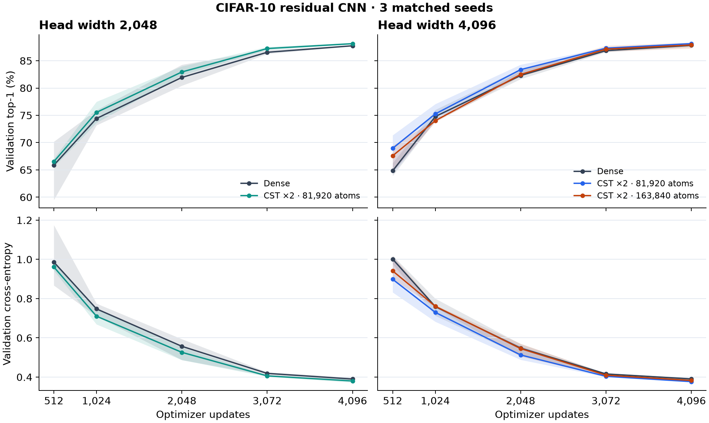
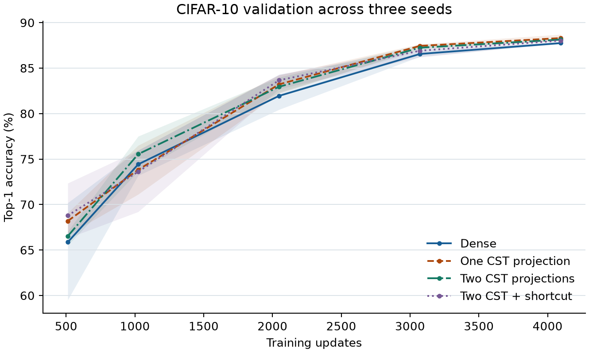

# CIFAR-10向け CST残差CNN

[English](README.md) | 日本語

## 分類ヘッド幅 2048 と 4096 の比較

分類ヘッドを2,048から4,096に広げても、**81,920 Atom**で、同じ幅のDense版に対する
テスト精度の差は平均**+0.29ポイント**でした。4,096幅の81,920 Atom版は3シード中
2シードでDenseを上回りました。163,840 Atomに倍増すると全3シードでDenseを上回り、
81,920 Atom版からの平均精度の上積みは0.023ポイントでした。

| ヘッド幅 | 構成 | Atom合計 | 平均テストTop-1 | 同幅Denseとの差 | 学習パラメータ数 | 1更新 | ピーク割り当てVRAM |
| ---: | --- | ---: | ---: | ---: | ---: | ---: | ---: |
| 2,048 | Dense | — | 87.793% | — | 4,978,410 | 4.23 ms | 595 MiB |
| 2,048 | CST 2層 | 81,920 | 88.083% | +0.29 pt | 849,642 | 6.66 ms | 687 MiB |
| 4,096 | Dense | — | 87.863% | — | 17,852,138 | 5.90 ms | 812 MiB |
| 4,096 | CST 2層 | 81,920 | 88.150% | +0.29 pt | 878,314 | 10.55 ms | 1,303 MiB |
| 4,096 | CST 2層 | 163,840 | 88.173% | +0.31 pt | 1,205,994 | 11.83 ms | 1,318 MiB |

81,920 Atom版は入力側に16,384 Atom、中央に65,536 Atomを使います。幅を広げると、
1更新にかかる時間は**6.66から10.55 ms**、ピーク割り当てVRAMは**687から1,303 MiB**に
増えました。4,096幅では学習パラメータ数はDenseの4.9%、1更新の時間は1.79倍、
ピーク割り当てVRAMは1.60倍でした。今回のCUDA学習では更新ごとに2つの重み行列を展開します。



曲線はシード17、23、42の平均と最小〜最大の範囲です。残差CNNの特徴抽出部、CIFAR-10の分割、
シードごとの画像順と拡張、バッチ256、RTX 4090での4,096更新を両方の幅で揃え、一から学習しました。
4,096幅では2,048幅で選んだ学習率を使いました。表の精度は最終チェックポイントを公式テスト
10,000枚で評価した値です。1更新の時間はGPU同期を含む学習ステップ全体を測り、各シードの
中央値を平均しました。VRAMは学習中のPyTorch CUDA割り当てのピークで、3シードの最大値です。

[設定と集計](results/width-comparison/summary.json) · [シード別結果](results/width-comparison/per-seed.csv) · [検証曲線のCSV](results/width-comparison/learning-curves.csv)

## 2048幅での初回実験

128→2,048→2,048→10の分類ヘッドを持つ小型残差CNNです。各版を一から全層学習しました。
CST 1層版では中央の2,048×2,048行列を65,536 Atomで表現し、2層版では入力側の
128→2,048も16,384 Atomで置き換えています。

| 方式 | 平均Top-1 | シード17 | シード23 | シード42 | 学習パラメータ数 | 1更新 |
| --- | ---: | ---: | ---: | ---: | ---: | ---: |
| Dense | 87.793% | 87.73% | 87.88% | 87.77% | 4,978,410 | 4.23 ms |
| CST 1層 | 88.040% | 88.04% | 88.11% | 87.97% | 1,046,250 | 5.99 ms |
| CST 2層 | 88.083% | 88.00% | 88.04% | 88.21% | 849,642 | 6.66 ms |
| CST 2層＋1×1 CSTショートカット | 87.923% | 87.68% | 87.98% | 88.11% | 842,676 | 9.08 ms |

CST 2層版は、3シード平均で学習パラメータを**82.9%削減**し、テスト精度が
**0.29ポイント**上がりました。1×1ショートカットは因子化実装を使った追試です。



[設定と集計](results/summary.json) · [シード別テスト結果](results/test-by-seed.csv) · [更新数ごとの検証結果](results/validation-by-step.csv)

RTX 4090一枚でバッチ256、4,096更新を実行しました。公式学習分割を学習45,000枚と検証
5,000枚に分け、最終チェックポイントを公式テスト10,000枚で評価しました。シード内で画像順、
画像拡張、共通層の初期値を揃えています。畳み込みはBF16、ヘッドはFP32です。更新時間は
元のCUDA学習処理で測った各シードの中央値の平均です。

## 推論

```bash
python -m pip install -r requirements.txt
python infer.py image.png --variant cst-two
python evaluate.py --data data --download --variant cst-two --device cuda
```

[Hugging Face](https://huggingface.co/takumiecd/cst-resnet-cifar10)では2,048幅のシード17から
Dense、CST 1層、CST 2層を配布しています。推論時は展開済みの行列を取得します。
RTX 4090では、各版についてテスト全10,000枚で元のチェックポイントと同じ出力を確認しました。
同じBF16の畳み込み経路を使うには `--device cuda` を指定します。

2つの `*-atoms.safetensors` にはヘッドの学習済みAtomを物理座標で保存しています。
取得したファイルからは、以下のコマンドでCPU上で行列を復元できます。推論CLIに
`config.json` と復元したファイルのあるディレクトリを指定することもできます。

```bash
python expand_atoms.py cst-two-atoms.safetensors cst-two.safetensors
```
