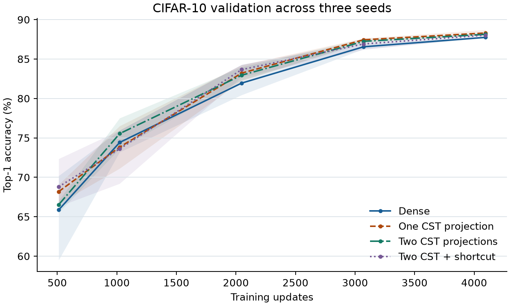

# CST residual CNN for CIFAR-10

English | [日本語](README.ja.md)

A small residual CNN with a 128→2,048→2,048→10 classifier head. Both CST
variants were trained end to end from scratch. One CST projection replaces
the 2,048×2,048 middle matrix with 65,536 Atoms. Two CST projections also
replace the 128→2,048 projection with 16,384 Atoms.

| Variant | Top-1 mean | Seed 17 | Seed 23 | Seed 42 | Trainable parameters | Training update |
| --- | ---: | ---: | ---: | ---: | ---: | ---: |
| Dense | 87.793% | 87.73% | 87.88% | 87.77% | 4,978,410 | 4.23 ms |
| One CST projection | 88.040% | 88.04% | 88.11% | 87.97% | 1,046,250 | 5.99 ms |
| Two CST projections | 88.083% | 88.00% | 88.04% | 88.21% | 849,642 | 6.66 ms |
| Two CST projections + 1×1 CST shortcut | 87.923% | 87.68% | 87.98% | 88.11% | 842,676 | 9.08 ms |

Two CST projections reduced trainable parameters by **82.9%** and mean test
accuracy rose by **0.29 percentage points** in this three-seed comparison.
The 1×1 shortcut was a follow-up that used a factorized implementation.



[Experiment settings and summary](results/summary.json) · [Per-seed test results](results/test-by-seed.csv) · [Validation snapshots](results/validation-by-step.csv)

All runs used one RTX 4090, 4,096 updates, and batch size 256. The official
training split was divided into 45,000 training and 5,000 validation images.
The table uses the final checkpoint and the full 10,000-image test split.
Within a seed, models used the same image order, augmentation and common
initialization. Training used BF16 convolution and FP32 head arithmetic.
The update times are means of the per-seed medians from the original CUDA
training path.

## Inference

```bash
python -m pip install -r requirements.txt
python infer.py image.png --variant cst-two
python evaluate.py --data data --download --variant cst-two --device cuda
```

The [Hugging Face release](https://huggingface.co/takumiecd/cst-resnet-cifar10)
includes the Dense, one-CST and two-CST checkpoints from seed 17. Inference
downloads the already materialized head matrices. On the RTX 4090, the
materialized export matched the original model logits on all 10,000 test
images for each checkpoint. Use `--device cuda` for the same BF16 trunk path.

The two compact `*-atoms.safetensors` files store the learned CST head
projections as physical Atoms. Fetch one from the Hub and reconstruct the
portable matrices on CPU with the following command. The inference script
also accepts a local directory containing `config.json` and the resulting
file.

```bash
python expand_atoms.py cst-two-atoms.safetensors cst-two.safetensors
```
